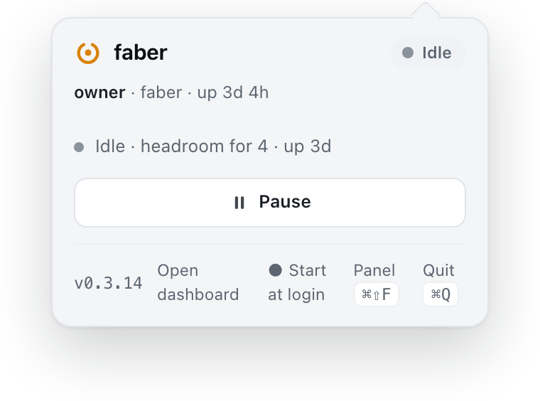
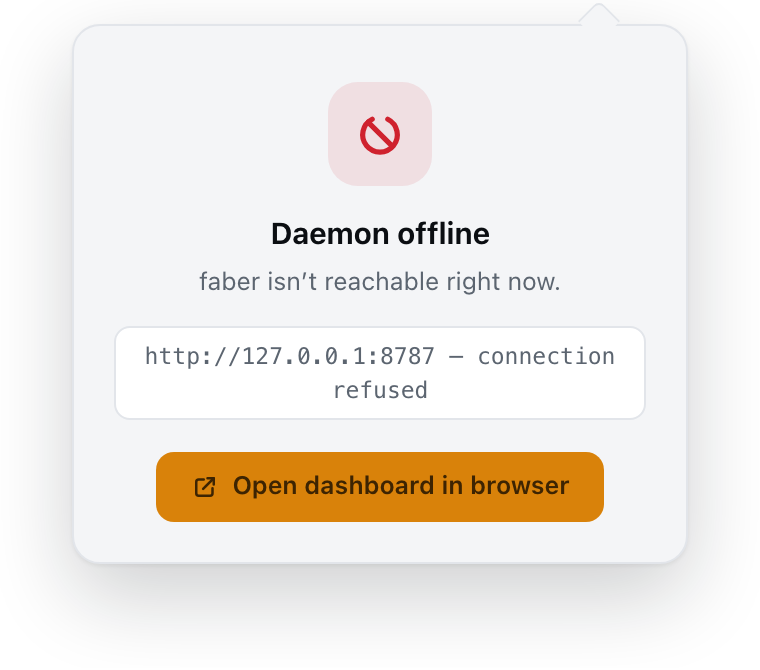

# The tray popover

Status: **decided by the owner on 2026-10-17**; implemented in React in `ui/`
(ADR-0042): `ui/src/screens/Popover.tsx`, its blocks in `ui/src/blocks/`.

A second pass was decided the same day: the menu-native restyle, job pips, the
peer as a row, and ghost actions. Its spec is
[popover/anatomy.md](popover/anatomy.md), and it is built, except the pips for
a finished job's CI verdict. Those need the daemon's `outcomes[].conclusion`,
which a follow-up adds. Since 2026-11-01 (owner) that verdict draws one muted
**done** pip whether CI passed or failed: a job's own failure is not faber's
to report, so red means faber's fault only.

A third pass was decided by the owner on 2026-10-26 (#368): **two columns while
jobs run**, the gauges as **bars** instead of rings, a peer as a **runner
count** with no mark (since 2026-10-31, a pip per runner), and folded job groups as **compact lines**. Its layout is
§ Layout below and [popover/anatomy.md](popover/anatomy.md) § 2 and § 6.

The popover is what opens when the operator left-clicks faber's menu-bar icon.
This page says what it is for and what it shows. Change it before changing the
popover's content, so the next addition is weighed against the job rather than
appended.

## Why it was redesigned

The previous popover grew by accretion. Thirteen banner sources competed for a
single banner slot, so only the first one that matched was ever shown and the
rest were silently hidden behind it. The hero was reserved memory in GiB, which
answers "how full is the ledger?" and not "can another job start?". Around it
sat a limits line, a 60-second load sparkline, since-launch counters and an
update block, with Reconcile as the primary button. Reconcile is a manual
nudge, and the daemon already reconciles on its own.

## Its one job

**Does faber need me?** Everything in the popover serves that question, in
this order:

1. what needs the operator (attention),
2. what limits admission right now (the hero),
3. what is running and waiting (jobs),
4. everything else, one quiet line each.

A healthy popover is calm and short. One that needs nothing collapses to a
single line.

## Layout, top to bottom

### Two columns while jobs run

Owner, 2026-10-26 (#368). While any job group shows, the card is 620 px wide
and the part between the attention list and the actions row splits in two:

```
┌───────────────────────────────────────────────┐
│ header                                        │
│ attention rows (full width)                   │
├──────────────────┬────────────────────────────┤
│ gates (each opens│ job groups                 │
│ in place)        │ …                          │
│ virtual machines │ compact lines              │
│ other hosts      │ › Show N more   ◔3 ◷2 ✓6   │
├──────────────────┴────────────────────────────┤
│ Pause / Resume                       Reconcile│
└───────────────────────────────────────────────┘
```

- The **left column** (240 px) holds this host's gauges, then its virtual
  machines (§ Virtual machines), then the other hosts.
- The **right column** holds the job groups. **Jobs never make the card
  taller:** the groups fold at the left column's height. The first groups
  show in full, the next as one compact line each (§ Jobs, grouped), and past
  what fits, "Show N more" with a count per pip kind opens the rest in place
  ([popover/fold.md](popover/fold.md), owner 2026-10-31). When compact lines
  let every group show, no group goes to the panel.
- The header, the attention list and the actions row span both columns.

With no job group (healthy idle, an issue but no jobs, loading, offline, the
Limits view) the card is the 308 px single column, the same parts stacked in
the same order. The window follows the card's width, its right edge fixed so
the beak stays under the menu-bar icon.

*Rejected* (2026-10-25): folded groups as only a link row, as a count in a
column header, and as one summary row with every pip merged. The compact lines
were picked.

### Header

Logo, name and one **⋯** button at the right. Nothing else (owner, 2026-10-17).

- **No status chip.** The chip repeated the attention list: Paused, Held,
  Draining, Unhealthy and Image missing each showed twice, once as the chip and
  once as a row. The list wins because it shows every issue with its action,
  where a chip can name only one, which was the old one-slot problem again.
  Running and Idle need no chip either: the job groups and the gauges say
  them, and the menu-bar glyph shows the state while the popover is closed.
- **No `owner · topic · up 3d` row.** It is not what the operator looks for at
  a glance. Owner and topic are set once and never change. Uptime is not shown
  in the popover at all; the panel has it.

The **⋯** button opens a small menu, drawn in the popover in the style of a
macOS menu:

```
faber v0.3.12 | app v0.3.11      (disabled; the app part only when it differs)
─────────────
Limits…
Settings…           ⌘,
Open panel          ⌘⇧F
Open dashboard
✓ Start at login
─────────────
Quit faber           ⌘Q
```

It collects what the footer used to carry. The menu is HTML rather than a
native `NSMenu`: the popover closes when it loses focus, and a native menu
takes key focus from it. The popover window grows while the menu is open if
the menu would not otherwise fit, as over the short offline popover. Escape
or a click outside closes it. ⌘⇧F and ⌘Q keep working with the menu closed.

### Attention list

Every active issue gets its own row. Rows are sorted by severity (red before
amber before neutral, otherwise in source order). At most three are shown; a
"Show N more" line with a count per severity opens the rest in place, and the
card grows to hold them ([popover/fold.md](popover/fold.md), owner 2026-10-31).

A row that does not stop jobs carries a quiet Dismiss (an `sm` ghost ×, labelled "Dismiss")
at its end ([ADR-0064](../adrs/0064-a-warning-that-does-not-stop-jobs-can-be-dismissed.md)).
Dismissed rows still active leave the list and its tally, and fold into one quiet line under
it, "N dismissed", which opens in place to list them, each with Restore (and Restore all for
more than one). Trust changes are acknowledged, not dismissed: each carries **Acknowledge**,
and the acknowledged ones fold into one neutral row, "N trust changes this week,
acknowledged", which opens to list them. The dashboard's alarm cards and the Memory view's
warning cards do the same, from the daemon's one list.

The sources are the thirteen banners the old popover chose between, the
pull-through mirror's three rows ([mirrors](../mirrors.md)), plus the
update notices that need the operator:

| Severity | Row | Action |
|---|---|---|
| bad | Profile image missing (#63) | — |
| bad | Mirror image missing, with the image and its build command in mono ([mirrors](../mirrors.md)) | — |
| bad | Mirror down, with how many jobs it affected ("Mirror down, 3 jobs affected"), since-when and the last error in mono. The runner names are the dashboard's, never the popover's ([mirrors](../mirrors.md)) | — |
| warn | Mirror passing through, with the reason ([mirrors](../mirrors.md)) | — |
| bad | Runner retiring, 3 days or fewer (#64) | — |
| bad | Can't reach GitHub | — |
| warn | Paused (ADR-0023) | Resume, in the actions row |
| warn | Docker admission held (#66) | **Release** |
| warn | Minting held for a repo (ADR-0030), one row per repo | **Clear** |
| warn | Draining | — |
| warn | Frozen under memory pressure | — |
| warn | Machine under pressure (ADR-0021 §2c) | — |
| warn | Docker VM too large (ADR-0021 §2a) | — |
| bad | A class OOM-killed on recent runs and held at the escalation threshold, with how many of its last runs it was killed on and the reservation it is held at (GiB, runner + dind); the worst named, the rest counted ([ADR-0053](../adrs/0053-an-oom-at-the-profiling-ceiling-grows-the-cap.md)) | **Pin at N GiB**: the caps the daemon says stop the OOMs (`pin_runner_mib` + `pin_dind_mib`), through `set_pin`, after an in-row confirmation (question, consequence, Cancel / **Pin**, focus on Cancel, Escape cancels: it grants past the threshold, #385); none from an older daemon |
| warn | Trust bypasses with enforcement off (ADR-0030) | — |
| warn | Jobs refused here (#95, #97) | — |
| warn | Runner retiring later (#64) | — |
| bad | Wall red, or its anchor out of date (ADR-0026) | — |
| warn | Linux image out of date (ADR-0026) | — |
| bad | No macOS VM session (ADR-0051), or no machine share for macOS VMs (ADR-0021), with how many macOS jobs wait and what to do; warn while none waits | — |
| bad | Golden image failed or not verified (ADR-0049 §7), with how many macOS jobs wait; warn while none waits; one not judged yet only once a job waits | — |
| warn | No room in the share for a macOS VM, only while a macOS job waits. Not the disk gate: Docker parks on it too | — |
| info | macOS VMs at the cap of 2 (ADR-0026) | — |
| warn | Update staged, waiting for idle (ADR-0006) | **Install now** / **Skip** |
| warn | Update maturity countdown (ADR-0031) | **Skip** |
| bad | Rolled back, or the updater's self-check is unproven or refused (#92) | — |

Each VM's state (`starting` … `stopped`, from the supervisor's fixed set) is one
quiet `VMs:` line under the attention list, shown beside the peer rows; the
panel shows the same states. A wall that has never been read is not a row: a
host without the wall has nothing to report.

Update notices join the list only when they need an action or report trouble.
Checking, downloading, a plain "available", deferred and failed phases are not
shown in the popover; the panel has them, and the ⋯ menu shows only the
version.

The maturity countdown is the one update notice shown without trouble.
ADR-0031 makes it "the alert the account cannot silence": a release published
quietly must still be visible on the owner's machine before it installs.

### Hero: the gauges

The hero is a stack of gauge bars and nothing else: no title, no subtitle. The
owner rejected every headline wording on 2026-10-17, because the gauges and the
attention list already say it. The stack replaces the memory-GiB hero, its meter
and the limits line. There is one bar per gate in force, each a row of its
caption, its real figures and a bar under them (owner, 2026-10-26: bars on both
widths; was: a row of 34 px rings, which had no room for the figures):

- **Slots**: shown only when a hard ceiling is set. It has one segment per
  slot, and a filled segment is a running Docker job. Figure: `3 / 6`.
- **Memory**: reserved against the budget. Figure: `5.5 / 8.0 GiB`.
- **CPU**: shown when the daemon reports a CPU budget. It is drawn faint, its
  figure ending ", not gated", unless `cpu = "auto"`. Figure: `3.0 / 8.0 cores`.
- **Disk**: the floor plus the ramp charges, against free space. Figure: the
  spare GiB above the floor (`120 GiB spare`), or the free GiB with no floor.

Memory, CPU and disk carry a **fit mark**: a tick at the point past which the
next job of typical size (`budget.headroom.job_mib` / `job_mcpu`, or the 3 GiB
disk charge) would no longer fit. A fill past the mark is why a claim waits.
The tick spans the bar's height and never sticks out.

The bar for the **binding gate** takes the accent colour, or amber while
something waits, and its caption keeps the gate's name with "binds" after it,
in the same tone ("Memory binds"; owner 2026-10-26). The binding gate is chosen
this way:

- **Something is waiting.** It is the gate with the most claims parked at it
  now (`budget.gates[g].parked_now`).
- **Nothing is waiting.** It is `budget.headroom.binds`.
- **An older daemon without `budget.headroom`.** No bar binds unless
  something waits, and there are no fit marks. The JS never estimates headroom. Gates no bar stands for
(hold, pause, Docker down, machine pressure) highlight none; the attention
list carries those. The gauges show in every online state, idle included.

**A gate opens in place** (owner, 2026-10-25, gauges direction A; built
2026-10-26, #370). Each bar is a row like a job group: pressing it lists what
the bar is made of under it, and **Adjust limits** at the end opens the Limits
view (below). One gate is open at a time; a job group may be open beside it
(owner 2026-10-26). Every line comes from a `budget`
field the daemon already sends, and a line whose field is missing is left out,
so an older daemon shows fewer lines. A field sent as 0 still shows its line.
Values are mono, words ("off", "auto, 6") as well as numbers, so they align
(owner 2026-10-26):

| Gate | Lines |
|---|---|
| Slots | Running *n of ceiling*; Free slots; Ceiling (the setting: a number, or `auto, n`) |
| Memory | Reserved by jobs; Free; Next job reserves (`headroom.job_mib`); Room for *n more jobs* (only while memory binds and nothing waits at it); Reserve sized by *75th percentile* (only when `reserve.in_force` is `p75`; the default, largest job, is not labelled) |
| CPU | Reserved by jobs; Free; Next job reserves (`headroom.job_mcpu`, only while gated) |
| Disk | Free on the host; Held by running jobs; Floor kept free and Spare above the floor (floor on), or Floor *off* |

A gate with claims parked at it (`budget.gates[g].parked_now`) ends on an amber
line, "3 jobs wait for memory". "Room for" is left out then, since it would
contradict the wait. In two columns an open gate makes the left column taller,
so the jobs column folds later (§ Two columns).

`budget.headroom` is computed by the daemon (`LimiterView::headroom` in
`src/limiter.rs`). The JS cannot compute it honestly, because it needs the
learned per-class sizes, the hard ceiling, the CPU mode and the disk floor
together:

- The typical job is the median of the learned classes' reservations, or what
  an unknown dind class would reserve when nothing is learned yet.
- When admission is shut outright, `jobs` is 0 and `binds` names why, in admission order: `held`, `paused`, the machine hold's gate,
  `docker`, `disk` (closed), `adoption`, `vm-memory` (frozen) or
  `cpu-pressure`.
- Otherwise each gate in force counts how many such jobs it would still admit:
  `ceiling`, `memory`, `vm-memory`, `cpu` (only when `cpu = "auto"`), and
  `disk` (only when the gate is on and its reading is fresh). The smallest
  count wins; on a tie, the gate admission checks first wins.
- The field is `null` while the memory budget is not measured yet.

### Limits view

Added by the owner on 2026-10-22 (spec: [settings/anatomy.md](settings/anatomy.md)). An open
gate's *Adjust limits*, or *Limits…* in the ⋯ menu, replaces the whole
card, header included, with a Limits view. It shows how the engine's memory divides (reserve,
jobs, free budget, headroom) and one stepper per live autolimiter knob: Hard ceiling,
Reserve, Headroom, Margin and Native jobs. Each change applies at once, with no Save;
a change that fails keeps its error and a Retry on its row. Back or Escape returns to
the main view, and *All settings…* opens the full settings.

This brings an editable form of the limits back into the popover, which the 2026-10-17
redesign had moved out. The glance is unchanged: the view opens only on request, and
the main view gains no line for it.

### Jobs, grouped

Jobs are grouped by PR (`demo/PR-123`), or by repo and workflow when there is
no PR (`site | Deploy`). Each group row shows its name, one pip per job, and
its age (anatomy § 2): running, frozen by the disk floor, waiting, and, for 10
minutes after the run, a red ring for a runner that failed on faber's side
(`outcomes[].result`). Over six pips the row shows the job count and a bar: one segment per job up to 10 jobs, then one per run of a kind. When every job in a
group waits, the collapsed row has no line: the clock pips say it waits, and the
job lines under the open group say what for (owner, 2026-10-31; was: an amber
"waits for …" line every time, noise when every group repeated the band). A group whose only
entries are failed runners keeps its row while they linger, and names the job.

Clicking a group expands it in place to list its jobs, each with its live step
(`i/n`) and elapsed time. Only one group is open at a time. The open group
survives the once-a-second snapshot updates.

A group folded past the gauge column's height (§ Two columns) is a **compact
line**: its name, one pip for its worst state, and its age (owner, 2026-10-26).
The pip is the same glyph a full row draws, the first present of runner
failed, frozen, waiting, running and done, so a folded group reads
like a full one. A compact line is not pressable. Past the full groups the
folded ones go worst first, so a runner failure always gets a compact line; the
"Show N more" line after the last one opens the rest in place, scrolling at the
column's height ([popover/fold.md](popover/fold.md), owner 2026-10-31).

### Virtual machines

Owner, 2026-10-29 (direction A with C's total; spec:
[popover/vms/anatomy.md](popover/vms/anatomy.md)). There is one row per VM this
host runs: a state icon (a grey dashed ring for every row while the list is stale), `Linux | 3 jobs` or `macOS | <job name>`, and the
age. No slot number (`#0`): it is the supervisor's index, fixed for the Linux engine, and
says nothing to a reader. The state is the icon's alone; the label names only what the VM
serves (owner, 2026-10-31). Each row opens in place like a gate to list its state in words while it is
settling, stopping or unmanaged, and what the VM was given (CPU,
memory) and, for Linux, its free disk (owner, 2026-10-31; was: a dot and an
always-shown mono spec line, and the section label carried the summed total). It sits under this host's
gauges and above Other hosts, and it shows **whenever a VM is up, idle included**,
because a running VM holds its memory. With no VM there is no section. While the
supervisor cannot be reached, the rows keep the last list, greyed, and the label
says how old it is.

*Replaced* the caption `VMs: linux #0 in service | …`, which showed no resources
and was hidden whenever the popover was idle. *Rejected:* VMs as segments of the
gate bars, and a VM table.

### Peer host

One row per peer (#94): `peer c3d4`, its runners as pips, and when it was
last seen (owner, 2026-10-31; was: the count in words, `2 runners`, and before
2026-10-26 a grey square per runner). The pips are the job row's strip, so a
peer reads like a job group and a pip means the same thing on both: a turning
arc per runner running a job, then a grey ring per idle one; an offline runner
has none. The daemon counts them from the runner listing's `busy` and `status`
(`PeerView.busy`, `PeerView.idle`). A peer still has no bar: there is no peer
ceiling (ADR-0004). The row turns amber once the peer has not been seen for
five minutes, and says `not seen` instead of pips: nobody knows which runners
still exist. With no runner it says `no runners`. An older daemon sends no busy
count, and every runner draws idle, a count that claims no work. In two columns
the peers sit under this host's gauges, under the "Other hosts" label.

### Actions

Pause/Resume is the only button: a ghost button, and the filled accent while
paused (Resume). Reconcile stays available as a small ghost icon button,
because the daemon reconciles on its own. This row is the
last one: there is no footer, and everything it held is in the ⋯ menu.

### Healthy idle

When the daemon is online and healthy, nothing needs attention and nothing is
in flight, the popover is the 308 px card: the header, the gauge bars stacked,
and Pause. The gauges
show always (owner, 2026-10-17): they are what the operator opens the popover
to see, idle or not. There is no idle text line: the empty job list and the
calm bars already say idle, and uptime is not glance information. A peer line
shows there only when that peer is stale. The Virtual machines section shows
there whenever a VM is up (owner, 2026-10-29): it explains the memory an idle
host still holds.

### Offline

When the daemon is offline, the popover collapses to the badge, the URL it
tried and "Open dashboard in browser". The header and its ⋯ menu stay, so
Quit, Start at login and the panel are still reachable; the menu shows the
app's own version, since the daemon's is unknown.

## What was removed, and where it went

| Removed | Where it is now |
|---|---|
| Since-launch tiles (provisioned / completed / faults / retried) | the panel and the web dashboard |
| Refused-since-launch strip | the live refused-queued set is an attention row; history is in the panel |
| 60-second load sparkline | the job groups say what is running; the Rust side still keeps `history` |
| Limits line (ceiling, CPU, machine) | the gauges; the binding gate is marked; the knobs are in the Limits view (2026-10-22) |
| Memory-GiB hero and meter | the gauges |
| The 34 px ring row (2026-10-26) | gauge bars with their figures, on both widths |
| A peer's grey runner squares (2026-10-26) | the runner count in words |
| Reconcile as the primary button | a secondary control |
| `VMs:` state caption, hidden when idle (2026-10-29) | the Virtual machines section, a row per VM with its resources |
| Status chip (2026-10-17) | the attention list; Running/Idle are said by the job groups and the gauges |
| `owner · topic · up` row (2026-10-17) | nowhere; uptime is in the panel |
| Idle line `Idle · headroom for 4 · up 3d` (2026-10-17) | the gauges, now shown in idle too |
| Footer: version, Open dashboard, Start at login, Panel, Quit (2026-10-17) | the ⋯ menu |

The menu-bar glyph became a stacked fraction on 2026-10-31: jobs running over jobs
claimed, from each job's `phase` ([desktop/README.md](../../desktop/README.md)). A job
row whose `phase` is `starting` (admitted, not yet started on GitHub) draws the waiting
pip and says "starting", so the popover and the glyph count the same jobs as running.

## Untrusted text

Operator hold reasons, repo-hold reasons, waiting reasons, job and branch
names, and the workflow names of fork or untrusted-actor jobs are set as text
nodes, never folded into HTML. For refused fork and untrusted-actor jobs, the
attention row shows only the repo, because the outsider controls the workflow
name.

## Screenshots

Rendered from canned `/api/state` fixtures (light theme). The fixtures cover
three running jobs, three jobs parked on memory, an operator hold plus five
other issues, healthy idle, and offline.

These captures are of the 2026-10-17 pass, at 308 px with rings. The third
pass (two columns, bars) is shown state by state by the `Screens/Popover`
stories in Storybook (`npm --prefix ui run storybook`).

| State | Before | After |
|---|---|---|
| Running | removed | removed |
| Running, a group opened | — | removed |
| Waiting | removed | removed |
| Several issues | removed | removed |
| Idle | removed |  |
| Offline |  |  |

The captures marked removed are no longer in this tree: they were of the 2026-10-17 layout,
which no story renders, so they could not be re-rendered, and the originals stay with the
legacy repository. Before was the layout that pass replaced: a large memory-reserved figure
over its budget with a bar and an in-flight count, a ceiling and CPU line, a 60-second load
sparkline, a card per running job (repo, PR, step, elapsed), an update card with Install now
and Skip, the since-launch counters, and Reconcile beside Pause. After was the pass itself: a status pill,
four rings (slots, memory, CPU, disk), a peer line, one row per job group (opened to list its
jobs, or with a memory note when the group is parked), a stack of attention rows above the
rings with "+3 more in the panel" for Several issues, and Pause beside a refresh button.
